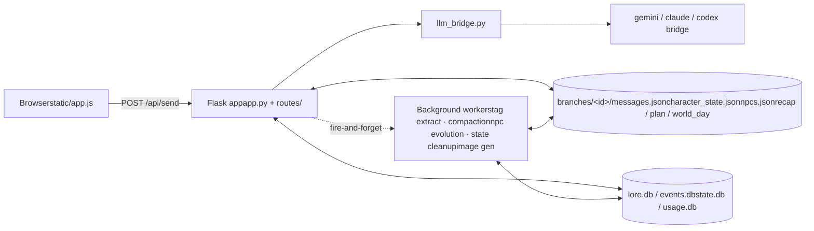
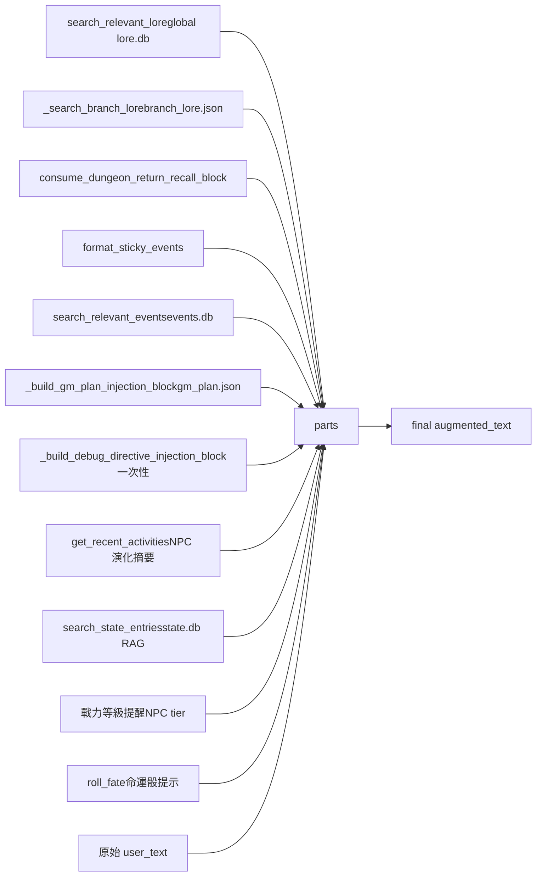
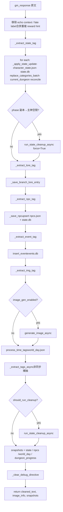
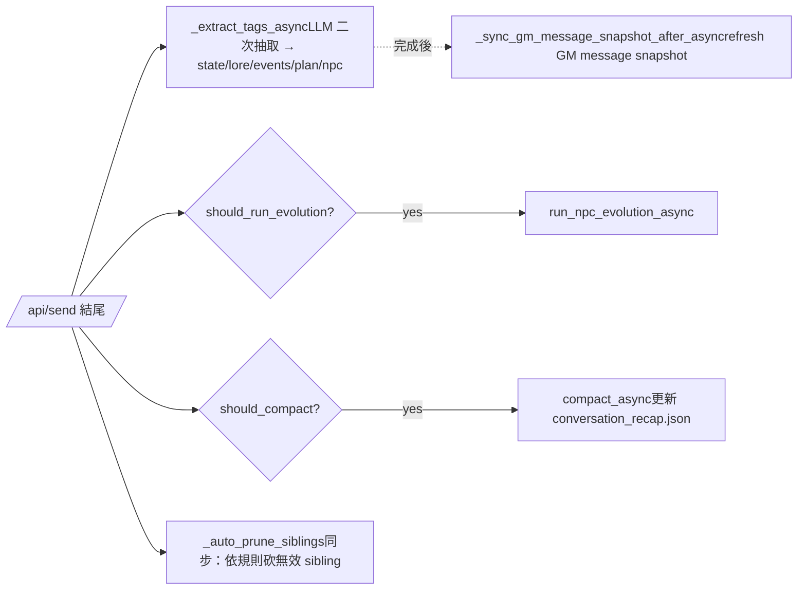
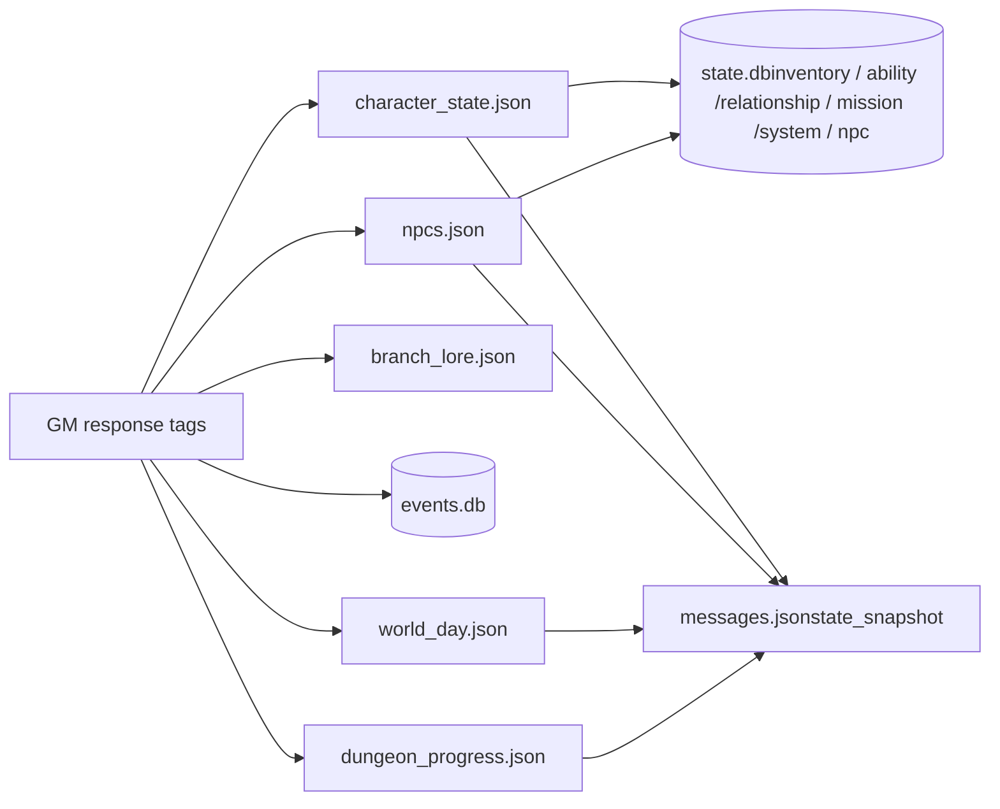

# 系統流程圖

聚焦在 `user input → prompt construction / memory / state transition → final output` 這條主管線。
所有圖都是 mermaid，可在 GitHub / VS Code preview 直接渲染。

對應程式碼入口：
- HTTP handler：[routes/core_routes.py:201](../routes/core_routes.py) `api_send` / `api_send_stream`
- Pipeline 內部：[story_core/gm_pipeline.py](../story_core/gm_pipeline.py)
- System prompt 組裝：[story_core/character_state.py:347](../story_core/character_state.py) `_build_story_system_prompt`

---

## 1. 元件總覽



---

## 2. `/api/send` 主管線（同步）

由 [routes/core_routes.py:201](../routes/core_routes.py) 驅動，每一步都在程式碼裡有對應 log line（`save_user_msg / build_prompt / context_search / claude_call / parse_tags / save_gm_msg`）。

```mermaid
flowchart TD
    A[POST /api/send{message, branch_id}] --> B[get_full_timelineparent chain + branch delta]
    B --> C[_upsert_branch_message寫入 user message]
    C --> D{is_gm_command?例：/gm dice}
    D -- yes --> D1[apply_dice_command更新 cheats]
    D -- no --> E
    D1 --> E

    E[載入 character_state · npcs · recap]
    E --> F[_build_story_system_promptfill system_prompt.txt 模板]
    F --> G[_build_augmented_message把 context 區塊拼到 user_text 前]
    G --> H[call_claude_gmllm_bridge.call_*]
    H --> I[_process_gm_response同步 tag 解析 + 套狀態]
    I --> J[_upsert_branch_message寫入 GM message + snapshots]
    J --> K[觸發背景 jobs]
    K --> L[_auto_prune_siblings]
    L --> M[Response{player, gm, pruned_branches}]

    F -. 模板來源 .-> F1[(story_design/&lt;id&gt;/system_prompt.txt)]
    H -. trace .-> T[(data/llm_traces/...)]
```

### 2.1 Augmented message 的組成（context injection）

`_build_augmented_message` ([gm_pipeline.py:1274](../story_core/gm_pipeline.py)) 把以下區塊串成 `…\n---\nuser_text`：



非 blank branch 才會注入 dungeon recall / sticky events / events / plan；`pistol_mode` 會跳過部分長期資料；`debug_directive` 注入後會在 `_process_gm_response` 結尾被 `_clear_debug_directive` 消耗掉。

### 2.2 System prompt 模板填值

`_build_story_system_prompt` ([character_state.py:347](../story_core/character_state.py)) 讀 `story_design/<id>/system_prompt.txt` 並 `format(...)`：

| placeholder | 來源 |
|---|---|
| `character_state` | `_build_core_state_text` |
| `world_lore` | `_build_lore_text`（global lore.db 摘要） |
| `npc_profiles` | `_build_npc_summary_text` |
| `narrative_recap` | `conversation_recap.json`（compaction 結果） |
| `team_rules` | `branch_config.team_mode` |
| `critical_facts` | `_build_critical_facts`（state + npcs 推導） |
| `dungeon_context` | `build_dungeon_context`（dungeon_progress.json） |

`fate_mode` / `pistol_mode` 會在最後對結果做區塊增刪。

---

## 3. `_process_gm_response`：同步 tag pipeline

[gm_pipeline.py:1080](../story_core/gm_pipeline.py)。GM 回覆進來、結構化資料寫出去、snapshot 落盤。



「同步 tag」走的是 regex 直解；「非同步 tag」由 `_extract_tags_async` 另外呼叫一次 LLM 做語意抽取，把 lore/events/plan/npc/state/time 補齊（細節見 [doc/architecture.md §6](architecture.md)）。

---

## 4. 背景 jobs（fire-and-forget）

`/api/send` 結尾觸發的非阻塞工作：



`_extract_tags_async` 跑完會回頭把對應 GM message 的 `state_snapshot / npcs_snapshot / world_day_snapshot / dungeon_progress_snapshot` 重寫一次，確保 timeline 上每個 GM 訊息的 snapshot 是最終態。

---

## 5. 資料寫入路徑速覽



`state.db` 是 JSON 真相源（`character_state.json` + `npcs.json`）的可檢索鏡像；`messages.json` 內每個 GM message 帶 snapshot，是 fork/edit/regen 時重建分支狀態的依據（見 [architecture.md §7](architecture.md)）。

---

## 6. 進一步閱讀

- [architecture.md](architecture.md) §5 同樣描述 `/api/send` 但以條列形式
- [prompt_design.md](prompt_design.md) system prompt 模板與設計原則
- [game_mechanics.md](game_mechanics.md) state / dungeon / fate 規則細節
- [agent-doc.md](agent-doc.md) workflow vs free-agent 的設計取捨
